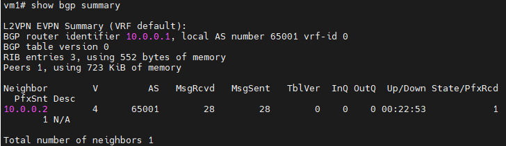
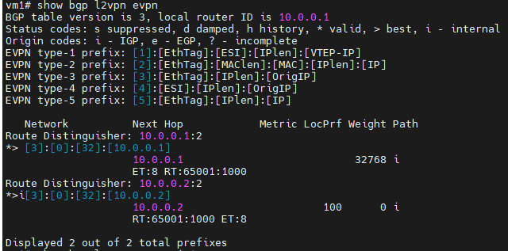
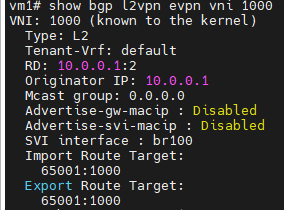
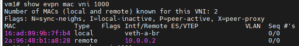
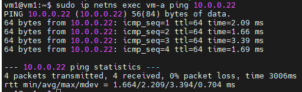

Lab này nâng cấp từ cơ chế VXLAN Flood-and-Learn sang cơ chế VXLAN kết hợp BGP EVPN

Flood-and-Learn khác BGP EVPN như thế nào?

Flood-and-Learn
- Học MAC qua data plane
- Flood khi chưa biết đích
- Dễ triển khai

BGP EVPN
- Học MAC qua control plane
- BGP quảng bá MAC/IP
- Giảm flooding không cần thiết

Mục tiêu của Lab: Tìm hiểu về:

- BGP EVPN dùng để trao đổi thông tin MAC/IP giữa các VTEP.
- Cách FRRouting (FRR) quảng bá thông tin EVPN qua BGP.
- Cách VM-A trên VTEP 1 giao tiếp với VM-B trên VTEP 2.
- Cách kiểm tra EVPN Route, MAC Address và ARP Cache.
- Điểm khác biệt giữa VXLAN Flood-and-Learn và VXLAN BGP EVPN.

Các thông số:

| Thành phần | VTEP 1 | VTEP 2 |
| :--- | :--- | :--- |
| BGP AS | 65001 | 65001 |
| Loopback | 10.0.0.1 | 10.0.0.2 |
| Underlay IP | 192.168.100.1 | 192.168.100.2 |
| VNI | 1000 | 1000 |
| VM IP | 10.0.0.11 | 10.0.0.22 |
| VM Subnet | 10.0.0.0/24 | 10.0.0.0/24 |

## Thực hành Lab

### Trên cả 2 server 

Cài FRR: `sudo apt install frr frr-pythontools`

Khởi động FRR:

```
sudo systemctl enable frr
sudo systemctl restart frr
sudo systemctl status frr
```

#### Cấu hình Underlay

Tạo Loopback:
```
sudo ip link add lo-vtep type dummy
sudo ip addr add 10.0.0.1/32 dev lo-vtep
sudo ip link set lo-vtep up
```

Định tuyến Loopback: `sudo ip route add 10.0.0.2/32 via 192.168.254.141`

#### Cấu hình VXLAN VNI 1000

```
sudo ip link add br100 type bridge
sudo ip link set br100 up
```

Tạo VXLAN interface:

```
sudo ip link add vxlan1000 type vxlan \
  id 1000 \
  local 10.0.0.1 \
  dstport 4789 \
  nolearning
```

Đưa VXLAN interface vào Bridge:

```
sudo ip link set vxlan1000 master br100
sudo ip link set vxlan1000 up
```

#### Tạo VM-A và VM-B bằng Network Namespace

Tạo namespace: `sudo ip netns add vm-a`

Tạo veth pair: `sudo ip link add veth-a type veth peer name veth-a-br`

Đưa interface vào namespace: `sudo ip link set veth-a netns vm-a`

Đưa đầu còn lại vào Bridge:
```
sudo ip link set veth-a-br master br100
sudo ip link set veth-a-br up
```

Gán IP cho VM-A:
```
sudo ip netns exec vm-a ip addr add 10.0.0.11/24 dev veth-a

sudo ip netns exec vm-a ip link set lo up
sudo ip netns exec vm-a ip link set veth-a up
```

### Cấu hình BGP EVPN bằng FRRouting

#### Cấu hình VTEP 1

Mở: `sudo nano /etc/frr/frr.conf`

Cấu hình:
```
frr defaults traditional
hostname vtep1
log syslog
service integrated-vtysh-config

router bgp 65001
 bgp router-id 10.0.0.1
 no bgp default ipv4-unicast

 neighbor 10.0.0.2 remote-as 65001
 neighbor 10.0.0.2 update-source lo

 address-family l2vpn evpn
  neighbor 10.0.0.2 activate
  advertise-all-vni
 exit-address-family
```

**Khởi động lại FRR trên cả 2 server:** `sudo systemctl restart frr`

### Kiểm tra

Mở CLI FRR: `sudo vtysh`

Kiểm tra BGP Neighbor: `show bgp summary` hoặc `show bgp l2vpn evpn summary`



Kiểm tra EVPN Route: `show bgp l2vpn evpn`



Kiểm tra VNI 1000: `show bgp l2vpn evpn vni 1000`



Kiểm tra MAC Address: `show evpn mac vni 1000`



Kiểm tra thực tế bằng ping: `sudo ip netns exec vm-a ping 10.0.0.22`



