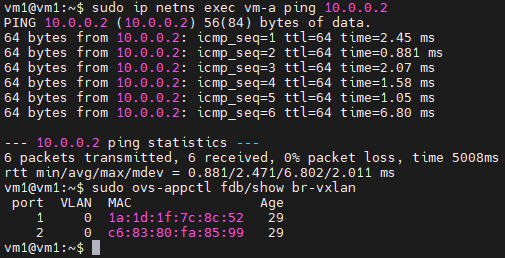

Lab này mô phỏng cách hai máy ảo (VM) nằm trên hai máy chủ vật lý khác nhau có thể giao tiếp với nhau thông qua mạng VXLAN, mặc dù chúng chỉ sử dụng địa chỉ IP nội bộ

Đây là một lab quan trọng để hiểu cách VXLAN được sử dụng trong các hệ thống Cloud, OpenStack và mạng ảo hóa

Mục tiêu của Lab:

- Tạo một OVS Bridge để chuyển tiếp frame Ethernet
- Tạo VXLAN Tunnel để kết nối hai Server qua mạng IP
- Dùng Linux Network Namespace để giả lập VM
- Kiểm tra cơ chế Flood-and-Learn bằng lệnh ping

Các lớp mạng

| Thành phần | Địa chỉ IP | Ý nghĩa |
| :--- | :--- | :--- |
| Server 1 | 192.168.254.139 | IP Underlay |
| Server 2 | 192.168.254.141 | IP Underlay |
| VM-A | 10.0.0.1 | IP Overlay |
| VM-B | 10.0.0.2 | IP Overlay |
| VXLAN VNI | 1000 | Định danh mạng VXLAN |
| UDP Port | 4789 | Cổng truyền VXLAN mặc định |

- Underlay là mạng IP vật lý giúp các Server liên lạc với nhau
- Overlay là mạng ảo mà VM sử dụng để giao tiếp
- VM-A không cần biết IP của Server 2
- VXLAN đóng gói frame Ethernet của VM thành gói UDP/IP để truyền qua Underlay

## Thực hành Lab

### Trên Server 1:

**Tạo OVS bridge**
`ovs-vsctl add-br br-vxlan`

**Thêm VXLAN tunnel port**
```
ovs-vsctl add-port br-vxlan vxlan0 \
  -- set interface vxlan0 \
  type=vxlan \
  options:remote_ip=192.168.254.139 \
  options:key=1000 \
  options:dst_port=4789
```
**Tạo namespace để giả lập VM**

Tạo namespace: `ip netns add vm-a`

Tạo cặp veth: `ip link add veth-vm-a type veth peer name veth-br-a`

Đưa interface vào namespace: `ip link set veth-vm-a netns vm-a`

Thêm đầu còn lại veth-br-a vào OVS Bridge: `ovs-vsctl add-port br-vxlan veth-br-a`

Gán địa chỉ IP cho VM-A: `ip netns exec vm-a ip addr add 10.0.0.1/24 dev veth-vm-a`

Đưa hai interface lên trạng thái hoạt động:

- `ip netns exec vm-a ip link set veth-vm-a up`

- `ip link set veth-br-a up`

### Trên Server 2 (tương tự, VM-B = 10.0.0.2)

**Test:**

Ping: `ip netns exec vm-a ping 10.0.0.2`

Kiểm tra bảng MAC của OVS: `ovs-appctl fdb/show br-vxlan`

