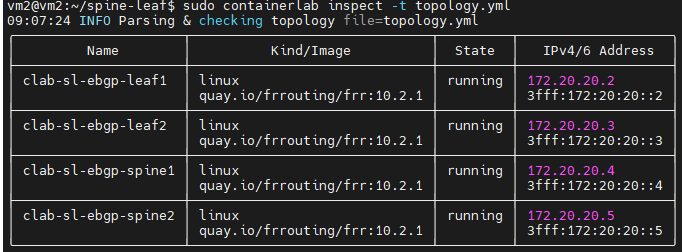
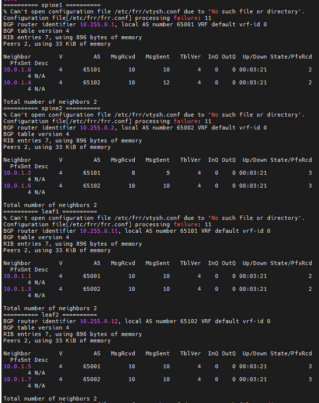
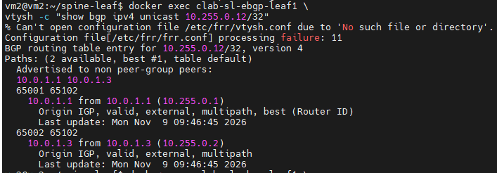

Lab triển khai một Data Center Fabric mô phỏng bằng Containerlab + FRRouting (FRR) trên Ubuntu/WSL2

Mục tiêu là nắm vững
- Các Leaf và Spine kết nối vật lý với nhau như thế nào
- eBGP thiết lập neighbor và trao đổi routing table ra sao
- Tại sao một Leaf có thể đi đến Leaf khác qua hai Spine
- ECMP được hình thành và hoạt động như thế nào
- Khi một Spine hoặc một uplink bị lỗi, traffic sẽ đi theo đường nào

### Dựng Spine-Leaf Topology

Sử dụng 4 router:
- Spine 1
- Spine 2
- Leaf 1
- Leaf 2

### Các thông số:

Loopback IP

| Router | Loopback | BGP ASN |
| :--- | :--- | :--- |
| Spine1 | 10.255.0.1/32 | 65001 |
| Spine2 | 10.255.0.2/32 | 65002 |
| Leaf1 | 10.255.0.11/32 | 65101 |
| Leaf2 | 10.255.0.12/32 | 65102 |

Point-to-point IP

| Kết nối | Thiết bị A | Thiết bị B |
| :--- | :--- | :--- |
| Leaf1 – Spine1 | Leaf1: 10.0.1.0/31 | Spine1: 10.0.1.1/31 |
| Leaf1 – Spine2 | Leaf1: 10.0.1.2/31 | Spine2: 10.0.1.3/31 |
| Leaf2 – Spine1 | Leaf2: 10.0.1.4/31 | Spine1: 10.0.1.5/31 |
| Leaf2 – Spine2 | Leaf2: 10.0.1.6/31 | Spine2: 10.0.1.7/31 |

### Các thư mục

```
spine-leaf/
│
├── topology.yml
│
└── configs/
    ├── spine1.conf
    ├── spine2.conf
    ├── leaf1.conf
    └── leaf2.conf
```

### Tạo topology bằng Containerlab

`nano topology.yml`

```
name: sl-ebgp

topology:
  nodes:
    spine1:
      kind: linux
      image: quay.io/frrouting/frr:10.2.1
      binds:
        - configs/spine1.conf:/etc/frr/frr.conf
      exec:
        - sysctl -w net.ipv4.ip_forward=1

    spine2:
      kind: linux
      image: quay.io/frrouting/frr:10.2.1
      binds:
        - configs/spine2.conf:/etc/frr/frr.conf
      exec:
        - sysctl -w net.ipv4.ip_forward=1

    leaf1:
      kind: linux
      image: quay.io/frrouting/frr:10.2.1
      binds:
        - configs/leaf1.conf:/etc/frr/frr.conf
      exec:
        - sysctl -w net.ipv4.ip_forward=1

    leaf2:
      kind: linux
      image: quay.io/frrouting/frr:10.2.1
      binds:
        - configs/leaf2.conf:/etc/frr/frr.conf
      exec:
        - sysctl -w net.ipv4.ip_forward=1

  links:
    - endpoints: ["leaf1:eth1", "spine1:eth1"]
    - endpoints: ["leaf1:eth2", "spine2:eth1"]

    - endpoints: ["leaf2:eth1", "spine1:eth2"]
    - endpoints: ["leaf2:eth2", "spine2:eth2"]
```

### Tạo file cấu hình Spine1 -> Spine2 -> Leaf1 -> Leaf2

```
frr defaults traditional
hostname spine1
log stdout
service integrated-vtysh-config
!
interface lo
 ip address 10.255.0.1/32
!
interface eth1
 ip address 10.0.1.1/31
!
interface eth2
 ip address 10.0.1.5/31
!
router bgp 65001
 bgp router-id 10.255.0.1
 no bgp ebgp-requires-policy
 !
 neighbor 10.0.1.0 remote-as 65101
 neighbor 10.0.1.4 remote-as 65102
 !
 address-family ipv4 unicast
  network 10.255.0.1/32
  neighbor 10.0.1.0 activate
  neighbor 10.0.1.4 activate
 exit-address-family
!
```

```
frr defaults traditional
hostname spine2
log stdout
service integrated-vtysh-config
!
interface lo
 ip address 10.255.0.2/32
!
interface eth1
 ip address 10.0.1.3/31
!
interface eth2
 ip address 10.0.1.7/31
!
router bgp 65002
 bgp router-id 10.255.0.2
 no bgp ebgp-requires-policy
 !
 neighbor 10.0.1.2 remote-as 65101
 neighbor 10.0.1.6 remote-as 65102
 !
 address-family ipv4 unicast
  network 10.255.0.2/32
  neighbor 10.0.1.2 activate
  neighbor 10.0.1.6 activate
 exit-address-family
!
```

```
frr defaults traditional
hostname leaf1
log stdout
service integrated-vtysh-config
!
interface lo
 ip address 10.255.0.11/32
!
interface eth1
 ip address 10.0.1.0/31
!
interface eth2
 ip address 10.0.1.2/31
!
router bgp 65101
 bgp router-id 10.255.0.11
 no bgp ebgp-requires-policy
 bgp bestpath as-path multipath-relax
 !
 neighbor 10.0.1.1 remote-as 65001
 neighbor 10.0.1.3 remote-as 65002
 !
 address-family ipv4 unicast
  network 10.255.0.11/32
  neighbor 10.0.1.1 activate
  neighbor 10.0.1.3 activate
  maximum-paths 2
 exit-address-family
!
```

```
frr defaults traditional
hostname leaf2
log stdout
service integrated-vtysh-config
!
interface lo
 ip address 10.255.0.12/32
!
interface eth1
 ip address 10.0.1.4/31
!
interface eth2
 ip address 10.0.1.6/31
!
router bgp 65102
 bgp router-id 10.255.0.12
 no bgp ebgp-requires-policy
 bgp bestpath as-path multipath-relax
 !
 neighbor 10.0.1.5 remote-as 65001
 neighbor 10.0.1.7 remote-as 65002
 !
 address-family ipv4 unicast
  network 10.255.0.12/32
  neighbor 10.0.1.5 activate
  neighbor 10.0.1.7 activate
  maximum-paths 2
 exit-address-family
!

```

**Triển khai**: `sudo containerlab deploy -t topology.yml`

**Kiểm tra**: `sudo containerlab inspect -t topology.yml`



### Thiết lập bgpd/zybra

```
for node in spine1 spine2 leaf1 leaf2; do
    echo "===== Configuring $node ====="

    docker exec clab-sl-ebgp-$node sh -c '
        grep -q "^zebra=" /etc/frr/daemons \
            && sed -i "s/^zebra=.*/zebra=yes/" /etc/frr/daemons \
            || echo "zebra=yes" >> /etc/frr/daemons

        grep -q "^bgpd=" /etc/frr/daemons \
            && sed -i "s/^bgpd=.*/bgpd=yes/" /etc/frr/daemons \
            || echo "bgpd=yes" >> /etc/frr/daemons
    '

    docker exec clab-sl-ebgp-$node \
        grep -E '^(zebra|bgpd)=' /etc/frr/daemons
done
```

### Kiểm tra kết nối Leaf1 đến hai Spine

`docker exec clab-sl-ebgp-leaf1 ping -c 3 10.0.1.1`

`docker exec clab-sl-ebgp-leaf1 ping -c 3 10.0.1.3`


### Kiểm tra BGP Neighbor

```
for node in spine1 spine2 leaf1 leaf2; do
    echo "========== $node =========="
    docker exec clab-sl-ebgp-$node \
        vtysh -c "show bgp ipv4 unicast summary"
done
```



### Kiểm tra ECMP:

```
docker exec clab-sl-ebgp-leaf1 \
    ip route show 10.255.0.12/32
```


