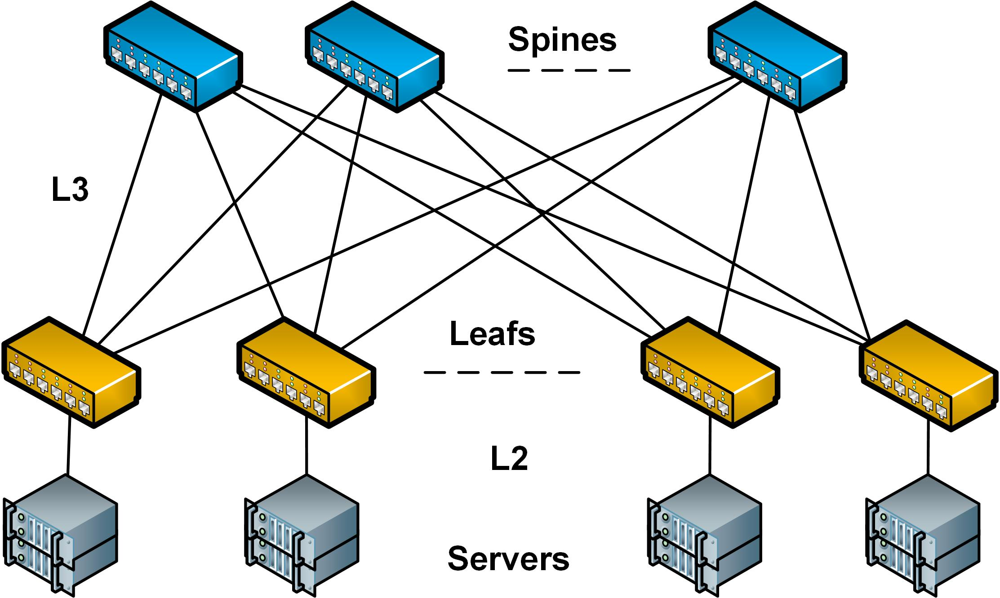
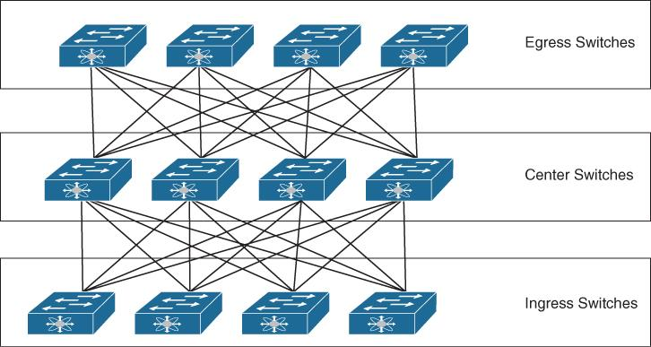

# 1. Tổng quan mối quan hệ giữa Spine-Leaf, Clos và VXLAN

| Công nghệ	| Vai trò | Chức năng |
| :--- | :--- | :--- |
| Clos | Kiến trúc topology | Thiết kế mạng nhiều tầng có khả năng mở rộng |
| Spine-Leaf | Mô hình triển khai Clos | Kết nối các thiết bị trong Data Center |
| VXLAN | Công nghệ Overlay | Tạo mạng Layer 2 ảo trên hạ tầng Layer 3 |

Có thể hình dung:

- **Clos**: Quy định cách tổ chức các thiết bị mạng
- **Spine-Leaf**: Cách triển khai Clos phổ biến trong Data Center
- **VXLAN**: Tạo các mạng logic độc lập chạy trên Spine-Leaf Fabric

# 2. Spine-Leaf Architecture

Là thiết kế mạng hai lớp hiện đại được phát triển để thay thế cho mô hình 3 lớp truyền thống (Core - Aggregation - Access) vốn bộc lộ nhiều hạn chế về độ trễ và băng thông trong các trung tâm dữ liệu hiện đại (nơi lưu lượng Traffic chủ yếu là East-West - giữa các máy chủ với nhau)

### Gồm 2 thành phần chính

1. Leaf Switch
    - Kết nối trực tiếp với server, firewall, router, load balancer
    - Thường đóng vai trò ToR (Top of Rack)
    - Là điểm truy cập vào Data Center Fabric
    - Có thể đảm nhiệm chức năng Layer 2 hoặc Layer 3
2. Spine Switch
    - Kết nối tất cả Leaf Switch
    - Chuyển tiếp traffic giữa các Leaf
    - Không kết nối trực tiếp với server trong mô hình Spine-Leaf cơ bản
    - Đảm bảo khả năng mở rộng và băng thông của Fabric

### Cách traffic hoạt động: 

Khi một gói tin đi từ Server A ở Leaf 1 đến Server B ở Leaf 2, nó chỉ cần đi qua tối đa 2 hop (Leaf 1 -> Spine bất kỳ -> Leaf 2). Mạng sử dụng giao thức định tuyến động Layer 3 kết hợp với ECMP (Equal-Cost Multi-Path) để phân tải lưu lượng đều lên tất cả các kết nối Spine-Leaf khả dụng, đảm bảo băng thông cực lớn và tính dự phòng cao (nếu một Spine Switch hỏng, hệ thống vẫn hoạt động bình thường với băng thông giảm đi một chút)

**Ví dụ:**
- Server A kết nối Leaf 1
- Server B kết nối Leaf 2
- Leaf 1 và Leaf 2 cùng kết nối Spine 1 và Spine 2

**Luồng traffic khi Server A gửi dữ liệu đến Server B:**
1. Server A gửi packet đến Leaf 1
2. Leaf 1 xác định đích nằm phía Leaf 2
3. Leaf 1 chọn một Spine làm next-hop
4. Spine chuyển packet đến Leaf 2
5. Leaf 2 chuyển packet đến Server B

### Đặc điểm quan trọng:

- Mỗi Leaf có kết nối đến tất cả Spine
- Có nhiều đường đi giữa hai Leaf
- Có thể sử dụng ECMP (Equal-Cost Multi-Path) để phân tải traffic
- Không có một đường uplink duy nhất trở thành nút thắt cổ chai

### Ưu điểm và hạn chế

| Ưu điểm | Hạn chế |
| :--- | :--- |
| Băng thông lớn | Tốn nhiều cổng uplink |
| Độ trễ thấp, ổn định | Chi phí đầu tư Spine |
| Dễ mở rộng | Cần thiết kế routing tốt |
| Hỗ trợ ECMP | Quản lý Fabric phức tạp |

# 3. Clos Network Architecture

Clos là kiến trúc mạng được phát triển từ mô hình switching nhiều tầng

Đặc trưng cốt lõi của CLOS là mô hình Non-blocking (không nghẽn): bằng cách phân chia cổng kết nối thành nhiều tầng switch nhỏ liên kết chéo, bất kỳ cổng vào nào cũng có thể kết nối với bất kỳ cổng ra nào mà không bị chặn bởi các kết nối khác đang diễn ra

Trong Data Center, Clos thường được triển khai dưới dạng:
- 2-stage Clos: Leaf-Spine
- 3-stage Clos: Leaf-Spine-Super Spine hoặc các biến thể nhiều tầng

